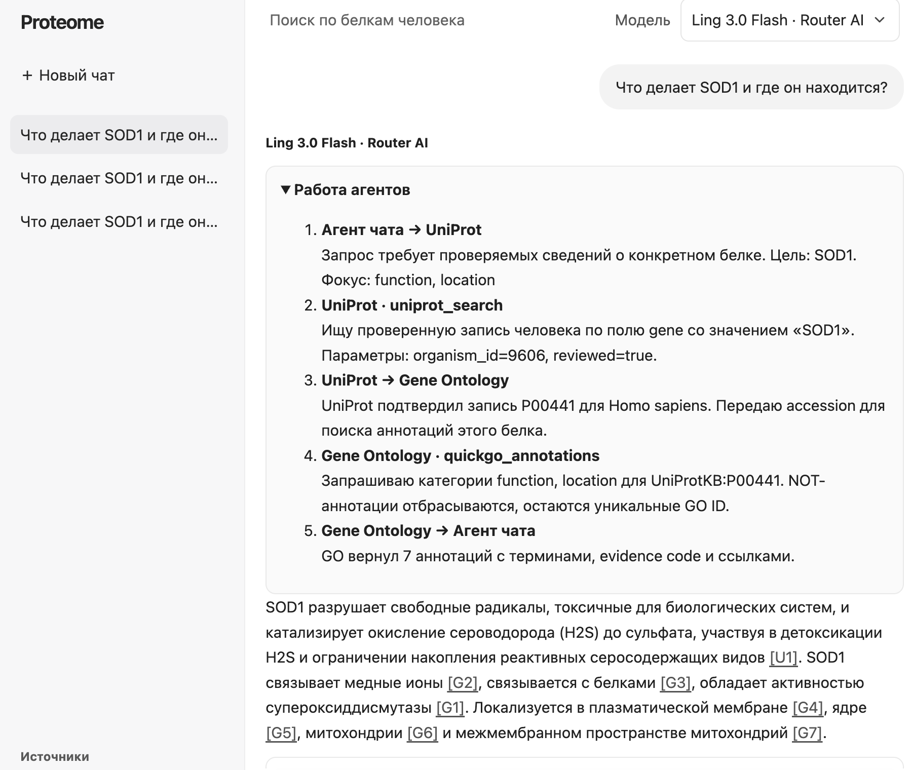
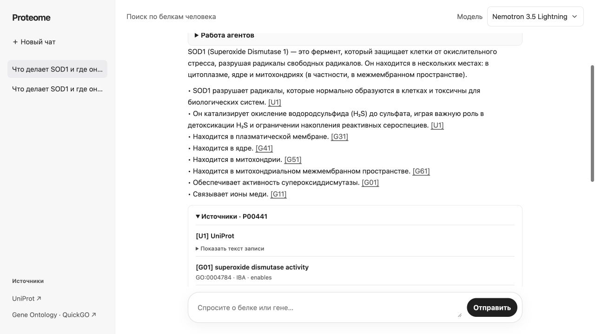

# Proteome

Proteome — веб-чат с мультиагентной системой для поиска информации о генах и белках человека. Система использует UniProt и Gene Ontology через QuickGO. Чат отвечает на языке пользователя и показывает ссылки на записи и журнал работы агентов.

[Открыть Proteome](https://proteome-routerai.normalaisle.chatgpt.site/)

## Как взаимодействуют агенты

| Агент | Решение | Что передаёт дальше |
| --- | --- | --- |
| Агент чата | Учитывает вопрос и историю. Решает, ответить сразу или искать сведения о белке. | Задачу агенту UniProt. После поиска составляет итоговый ответ. |
| Агент UniProt | Выбирает поиск по символу гена или английскому названию белка. | Проверенную запись человеческого белка, её идентификатор и описание функции. |
| Агент Gene Ontology | Получает вопрос и запись UniProt. Выбирает, нужны ли данные GO и какие категории запросить. | Термины GO, коды доказательств и ссылки на записи или публикации. |

Сервер передаёт структурированные данные между ролями. Все роли используют модель Router AI, каждая со своим промптом. Журнал «Работа агентов» показывает передачи задач, вызовы инструментов и результаты вызовов.

На вопрос «Что делает SOD1 у человека?» агент чата запускает поиск. UniProt возвращает запись `P00441`. Агент GO использует её идентификатор для поиска аннотаций в QuickGO. Модель получает записи обоих источников вместе с вопросом и составляет ответ. Это RAG с прямым поиском через API. Сервер проверяет, что метки в ответе относятся к полученным записям, а интерфейс превращает их в ссылки.

## MCP и источники

На `POST /mcp` доступны JSON-RPC методы `initialize`, `tools/list` и `tools/call`. Чат вызывает тот же обработчик инструментов внутри Worker.

- `uniprot_search` принимает `query` и `field` (`gene` или `protein`). Поиск ограничен проверенными записями белков человека. [UniProt API](https://www.uniprot.org/api-documentation)
- `uniprot_get_entry` получает проверенную запись по accession.
- `quickgo_annotations` принимает `accession` и список категорий `focus` из `function`, `process`, `location`. [QuickGO API](https://www.ebi.ac.uk/QuickGO/api/)

[Пример MCP-сервера преподавателя](https://github.com/EdwFa/MCP_calc/tree/main)

## Сборка и запуск

Нужны Node.js 22+, Bash и ключ Router AI для запросов к модели. Задайте `ROUTERAI_API_KEY` в окружении. Для опубликованной версии задайте его как секрет в Sites.

```bash
npm run build
npm run validate
npm start
```

Локальный сайт доступен на `http://127.0.0.1:8765/`. История хранится в браузере. Доступность модели зависит от квот Router AI, а научные утверждения следует сверять по записям источников.

`worker/index.html` содержит интерфейс, `worker/index.js` — агенты и MCP-инструменты. Сборка объединяет их в Worker для Sites.

## Демонстрация работы

**Взаимодействие трёх агентов.** Агент чата передаёт запрос агенту UniProt. Тот находит SOD1 и передаёт запись `P00441` агенту Gene Ontology. Агент GO возвращает семь аннотаций через QuickGO.



**Источники ответа.** Под ответом доступны запись UniProt, термины Gene Ontology, коды доказательств и ссылки на публикации.



## Текущая реализация

Рабочий веб-чат использует Node.js Worker и модель `inclusionai/ling-3.0-flash` через `https://routerai.ru/api/v1`. Для запуска установите `ROUTERAI_API_KEY` в окружении сервера. Python-пакеты `app/` и `mcp_server/` являются отдельным незавершённым прототипом и не обслуживают веб-чат.

Проверка ссылок подтверждает существование меток в полученных данных. Она не проверяет смысл каждого утверждения. Ответы модели и переводы терминов следует сверять с источниками. Например, связь `colocalizes_with` в GO означает колокализацию, и модель может ошибочно передать её как локализацию.
